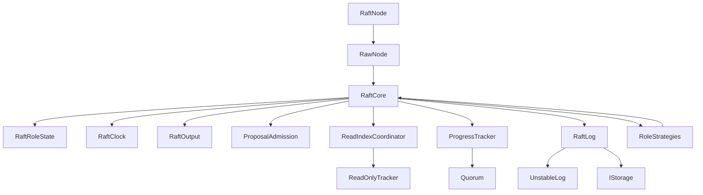

# Reference Architecture

This page maps the current C# implementation. The [host integration contract](public-api.md)
specifies ordering and recovery; the [design index](design/README.md) links the
decisions and historical port records.

## Architectural boundary

```text
host input: peer message, tick, proposal, or work completion
    -> serialized RawNode call -> deterministic RaftCore step
    -> Ready: persistence, transport, application, and read work
    -> host executes the work -> Advance or local storage responses
```

`RaftCore` chooses log and membership transitions without running host
effects. `IStorage` gives it a synchronous stable read view, including when
async storage **writes** are enabled. `RaftNode` serializes calls into
`RawNode`; it does not run the Ready consumer or implement a second protocol.

| Boundary | Owner | Not its job |
|---|---|---|
| Consensus | [`RaftCore`](../src/DotnetRaft/Core/RaftCore.cs) | Sending on sockets, writing databases, or executing commands |
| Ready and acknowledgements | [`RawNode`](../src/DotnetRaft/RawNode.cs), with [`RaftNode`](../src/DotnetRaft/RaftNode.cs) as the concurrent facade | Performing the host's work or declaring it complete independently |
| Stable storage | [`IStorage`](../src/DotnetRaft/Storage/IStorage.cs) implemented by [`MemoryStorage`](../src/DotnetRaft/Storage/MemoryStorage.cs) or the optional [SQLite package](../src/DotnetRaft.Sqlite/README.md) | Deciding what is committed, or storing the application state machine |
| Transport and application | The consuming host; see the [counter](../examples/DotnetRaft.Counter/README.md) and [durable KV example](../examples/DotnetRaft.KvCluster/README.md) | Reimplementing consensus or conflating Raft acknowledgement with actual application |

## Implemented C# core boundaries



| Component | What it owns |
|---|---|
| [`RaftCore`](../src/DotnetRaft/Core/RaftCore.cs) | Cross-component sequencing: term routing, log mutation, commit and read admission, configuration installation, and completion ordering |
| [`RaftRoleState`](../src/DotnetRaft/Core/RaftRoleState.cs), [`RaftClock`](../src/DotnetRaft/Core/RaftClock.cs) | Term, vote, leader, role and transferee; election and heartbeat timers and randomized timeouts |
| [`RaftOutput`](../src/DotnetRaft/Core/RaftOutput.cs) | Outbound normalization, cloning, immediate and after-append queues |
| [`RaftLog`](../src/DotnetRaft/Core/RaftLog.cs), [`UnstableLog`](../src/DotnetRaft/Core/UnstableLog.cs) | Merged log bounds, matching, commit/apply cursors; entries and snapshots awaiting stable acknowledgement |
| [`ProgressTracker`](../src/DotnetRaft/Tracker/ProgressTracker.cs), [`ConfigurationChanger`](../src/DotnetRaft/ConfChange/ConfigurationChanger.cs) | Installed voters, learners and replication progress, quorum calculations; validation and construction of a candidate membership change |
| [`ProposalAdmission`](../src/DotnetRaft/Core/ProposalAdmission.cs), [`ReadIndexCoordinator`](../src/DotnetRaft/Core/ReadIndexCoordinator.cs) | Uncommitted payload and pending configuration index; gated requests, read quorums, and completed read states |
| [`RaftRoleStrategies`](../src/DotnetRaft/Core/RaftRoleStrategies.cs) | Stateless dispatch for messages routed to a role, selected from the current role after shared term handling |

The role strategies call explicit handlers on the core. Its other collaborators
do not depend on the aggregate. Mutable state has one owner, and tests use
component fixtures or explicit test hooks rather than writable forwarding
properties. See [ADR 0003](adr/0003-raftcore-structural-boundaries.md).

## Important invariants

| Area | What to preserve |
|---|---|
| [Elections](learning/01-safety-and-elections.md) | Terms never go backward; there is at most one real vote per term; a granted vote requires an up-to-date candidate log. |
| [Log and replication](learning/02-log-and-replication.md) | Entries are contiguous and terms do not decrease within a log. A committed entry is never overwritten. `Match < Next`; only a current-term entry can advance leader commit by counting replicas. |
| [Ready and recovery](learning/03-ready-and-recovery.md) | `Applied <= Applying <= Committed <= LastIndex` is a core invariant, not the host's physical cursor. A real vote grant or successful append must not attest work that has not crossed the required durability barrier. |
| [Membership and reads](learning/04-membership-reads-and-liveness.md) | Joint consensus requires both majorities; learners do not vote. An accepted configuration takes effect when applied, not when appended. ReadIndex does not replace physical application. |

## Test architecture

Use the [testing lab](learning/05-concurrency-and-testing.md) for runnable
commands and the [parity matrix](parity-matrix.md) for reference coverage. ABA
is the case where a log tail returns to the same `(index, term)` while an
older write acknowledgement is still in flight.
Choose evidence for the boundary that changed:

| Boundary | Where to look |
|---|---|
| Consensus transitions, including snapshot and membership installation | [Core tests](../tests/DotnetRaft.Tests/Core/), [role dispatch approvals](../tests/DotnetRaft.Tests/Core/RaftCoreDispatchCharacterizationTests.cs) |
| Ready identity, persistence, and early admission | [`RawNodeReadyTests`](../tests/DotnetRaft.Tests/RawNode/RawNodeReadyTests.cs), [`RawNodePersistenceTests`](../tests/DotnetRaft.Tests/RawNode/RawNodePersistenceTests.cs) |
| Async worker routing, supersession, and ABA | [Async storage tests](../tests/DotnetRaft.Tests/AsyncStorage/), [SQLite response routing](../tests/DotnetRaft.Sqlite.Tests/SqliteStorageRawNodeTests.cs) |
| Owner-loop races versus interleaved cluster failures | [RaftNode tests](../tests/DotnetRaft.Tests/Node/), [cluster lab tests](../tests/DotnetRaft.Tests/Interaction/RaftLabTests.cs) |
| Atomic publication and process restart | [SQLite durability tests](../tests/DotnetRaft.Sqlite.Tests/SqliteStorageDurabilityTests.cs), [KV recovery tests](../tests/DotnetRaft.Tests/Examples/DurableKvComponentTests.cs), [real-process smoke](../eng/smoke-durable-kv-cluster.sh) |

## Reference snapshot

The Go comparison is pinned to [`etcd-io/raft` at `1c0011d`](https://github.com/etcd-io/raft/tree/1c0011d2c6b7a0230f87bad38ad4c6e70d810f9e).
This pin identifies the behavioral baseline, not the current C# layout. See
the [parity matrix](parity-matrix.md#intentional-deviations) for later fixes and
intentional differences.
The [original reference analysis](https://github.com/algorithm-apprentice/dotnet-raft/blob/45160468cb7a0a3465c5fbebf088b5998188890b/docs/reference-architecture.md#reference-snapshot)
has the detailed Go package and source map.

### Component map

`raftpb` and `quorum` are dependency leaves. `tracker` uses both;
`confchange` builds on `tracker`. The root `raft` package composes the
state machine and host-facing APIs. `rafttest` drives that API from outside
and supplies the basis for the pinned C# interaction corpus. The
[porting timeline](implementation-dag.md) records the order in which these
responsibilities were brought over.
